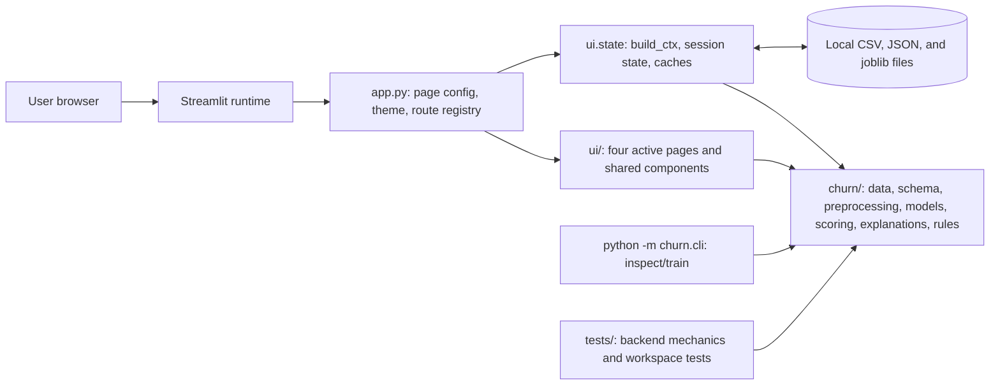
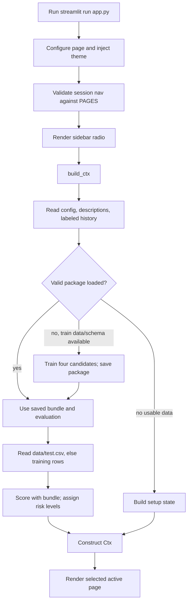
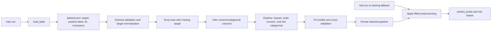
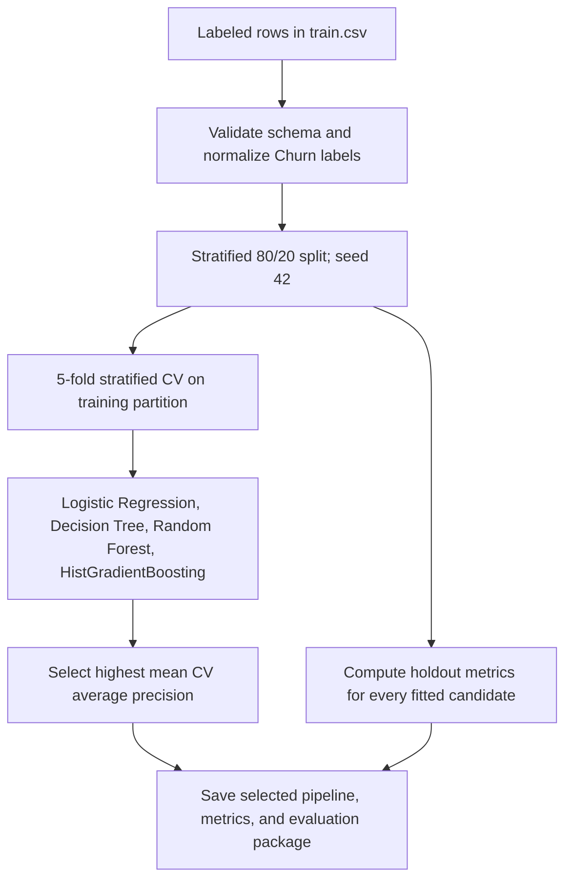
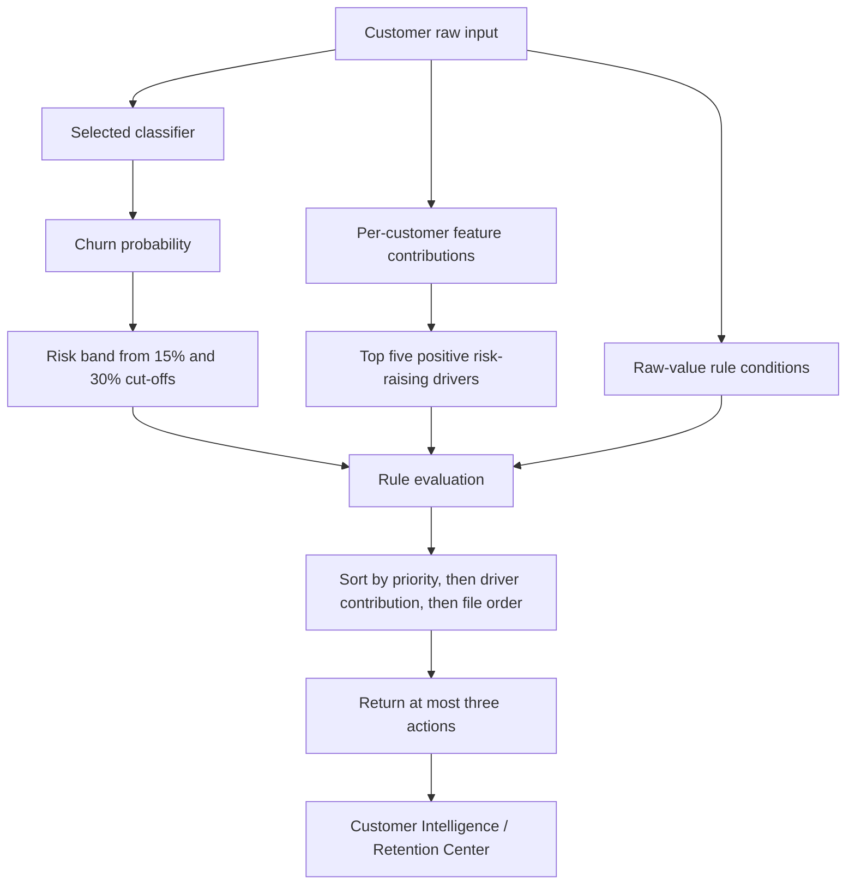
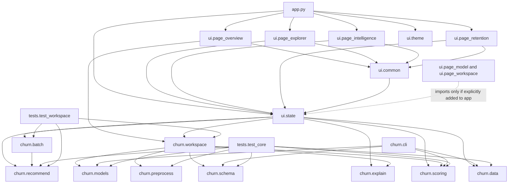

# Churn Intelligence: Technical Audit

Audit date: 31 October 2026. This document describes the files and data present in this workspace, not a proposed redesign. The supplied master prompt is truncated after the heading `2. Development` under its final file-classification section; this audit covers all visible requirements and uses explicit labels where the missing remainder could matter.

## React/FastAPI Conversion Update (31 October 2026)

The original Streamlit interface remains intact as a fallback. The new primary web implementation is `frontend/` (React/Vite/Tailwind/React Router/Recharts/Lucide) backed by `backend/` (FastAPI) and the existing framework-independent `churn/` business logic. It provides Overview, Customer Explorer, Customer Intelligence, Model Insights, Retention Center, and Prediction Workspace. See `README.md` for local setup, route-to-feature mapping, and Render/Vercel deployment settings. The original implementation audit below records the Streamlit baseline and the real data/model results reused by the React app.

The FastAPI adapter exposes `/api/health`, `/api/bootstrap`, `/api/overview`, `/api/customers`, `/api/customers/{customer_id}`, `/api/model-insights`, `/api/retention`, `/api/workspace/status`, and Workspace POST routes for train upload, training, score upload, risk bands, reset, and full CSV export. Session IDs isolate browser uploads and risk-band overrides in process memory with TTL/cap eviction. Model training, preprocessing, predictions, explanations, metrics, and retention rule matching remain in the existing Python modules.

Vercel incident: the deployment failed at `/vercel/path0/frontend/node_modules/.bin/vite: Permission denied`. Inspection proved that 9,064 files under `frontend/node_modules` and generated `frontend/dist` outputs were tracked from Windows, including `.bin/vite` and `esbuild` executables with Git mode `100644`. Vercel therefore received non-executable Windows-installed artifacts instead of a clean Linux dependency install. The fix stages these generated paths for removal from Git, ignores only `frontend/node_modules/` and `frontend/dist/`, and explicitly approves esbuild's required npm install script through `frontend/package.json` `allowScripts`. No `.env`, dataset, model, or general safety ignore rules were re-enabled. Local clean `npm ci` and `npm run build` both pass after the change. The Vercel deployment itself still needs a commit/push and redeploy to verify remotely.

Conversion verification: `python -m unittest discover tests` runs 46 passing tests (including four synthetic FastAPI API contract tests); `npm --prefix frontend ci` succeeds; `npm --prefix frontend run build` succeeds. Playwright checked the real-data Overview at desktop and mobile widths, Explorer filtering, customer profile/recommendations, and all six routes. No page-level horizontal overflow was observed at 390px mobile width. This is local verification only; it is not evidence of a production deployment.

## Executive Summary

The audited baseline is a Python/Streamlit application backed by pandas and scikit-learn. That legacy entry point exposes four pages: Overview, Customer Explorer, Customer Intelligence, and Retention Center. Its Model Insights and Prediction Workspace modules remain in `ui/`, but the legacy `app.py` does not route to them. The new React frontend restores all six workflows and talks to FastAPI; neither frontend is embedded in the other.

The active application reads `data/train.csv`, `data/test.csv`, `config/dataset.json`, `config/rules.json`, and optionally `data/data_descriptions.csv`. It loads `models/model.joblib` if it is valid; otherwise it trains on labeled history and saves a package. The current package contains a Logistic Regression pipeline and a held-out evaluation. `data/test.csv` has no churn target and is used only for scoring.

Evidence collected from the actual workspace:

- Python 3.14.3, pandas 3.0.3, scikit-learn 1.9.0 in the selected VS Code interpreter.
- `python -m unittest discover tests`: 42 tests passed. The fixtures are synthetic; this does not establish model quality on their own.
- Workspace diagnostics: no errors reported.
- Both real CSVs and both local `.joblib` artifacts were read successfully. No customer identifiers or row-level records are reproduced here.
- The current `models/model.joblib` contains the held-out evaluation described below. It was generated 30 October 2026 at 03:40:36 UTC.

## Architecture

### Overall System Architecture



The active UI is a single Streamlit script, not a separate JavaScript frontend and API service. `churn/` does not import `ui/`. The command-line tool is independent of the dashboard. The `ui/page_model.py` and `ui/page_workspace.py` modules are present but are not reachable from the active route registry.

### Application Execution Flow



Automatic training is attempted only when no usable package is present, labeled data and a valid schema are available, and the session has not recorded an automatic-training failure. A changed `train.csv` is marked stale; the current live UI does not provide a retraining control.

### Data Processing Pipeline



### Machine Learning Pipeline



When an ID repeats, the trainer uses a group split and stratified group folds to keep records for the same ID on one side. In the inspected training file, IDs are unique, so the actual split was ordinary stratified random splitting, not grouped or time-based.

### Prediction Workflow

```mermaid
sequenceDiagram
    participant U as User
    participant A as app.py
    participant S as ui.state.build_ctx
    participant D as CSV files
    participant M as Saved model
    participant P as Pipeline
    U->>A: Open page or interact
    A->>S: Build current context
    S->>D: Read train.csv and config
    S->>M: Load model.joblib if valid
    alt no usable package and valid labeled history
        S->>P: Train and evaluate candidates
        S->>M: Save bundle plus evaluation
    end
    S->>D: Read test.csv; if absent use training rows
    S->>P: Transform inputs and predict_proba
    P-->>S: Churn probabilities
    S->>S: Assign Low/Medium/High bands
    S-->>A: Ctx with scores and derived views
    A-->>U: Render selected page
```

### Recommendation Generation Workflow



The classifier estimates risk. The rules do not alter the probability and are not trained from outcomes. They produce suggested actions from risk band, model drivers, and raw feature conditions.

### Project File Dependency Diagram



## Data and Schema

### Active datasets

| File | Observed shape | Role | Quality observations |
|---|---:|---|---|
| `data/train.csv` | 243,787 rows x 21 columns | Labeled history, training, holdout evaluation, historical patterns | 0 duplicate rows, 0 missing cells, 243,787 unique `CustomerID` values |
| `data/test.csv` | 104,480 rows x 20 columns | Unlabeled portfolio to score; not used for model evaluation | 0 duplicate rows, 0 missing cells, no `Churn` column, no ID overlap with train |
| `data/data_descriptions.csv` | 21 described columns | Optional feature/target/identifier dictionary | Loaded defensively; missing or unreadable file yields an empty description map |

`train.csv` has 18 business inputs, `CustomerID`, and `Churn`. Observed labels: 199,605 non-churn and 44,182 churn; churn prevalence is 18.1232%. `test.csv` has no labels, so its score distribution is descriptive only and has no measurable accuracy, precision, recall, or AUC.

The data dictionary describes a streaming/entertainment subscription context. No source URL, collection methodology, license, or provenance record is present in the inspected project; the original source and whether the data is synthetic cannot be established from the files.

### Features

| Column | Type in active model | Data dictionary meaning / treatment |
|---|---|---|
| `AccountAge` | Numeric | Account age in months. |
| `MonthlyCharges` | Numeric | Monthly amount charged; currency is not specified. |
| `TotalCharges` | Excluded numeric | Lifetime charges. Within absolute tolerance $10^{-12}$, equals `AccountAge * MonthlyCharges` on all 243,787 training rows; excluded in `config/dataset.json`. |
| `SubscriptionType` | Categorical | Basic, Standard, or Premium subscription. |
| `PaymentMethod` | Categorical | Bank transfer, credit card, electronic check, or mailed check. |
| `PaperlessBilling` | Categorical | Paperless billing enabled (Yes/No). |
| `ContentType` | Categorical | Movies, TV Shows, or Both. |
| `MultiDeviceAccess` | Categorical | Multi-device access (Yes/No). |
| `DeviceRegistered` | Categorical | Computer, Mobile, TV, or Tablet. |
| `ViewingHoursPerWeek` | Numeric | Weekly viewing hours. |
| `AverageViewingDuration` | Numeric | Average viewing-session duration in minutes. |
| `ContentDownloadsPerMonth` | Numeric | Monthly downloads. |
| `GenrePreference` | Categorical | Action, Comedy, Drama, Fantasy, or Sci-Fi. |
| `UserRating` | Numeric | Service rating on a 1–5 scale. |
| `SupportTicketsPerMonth` | Numeric | Monthly support tickets; interpreted as a service-friction proxy, not a complaint outcome. |
| `Gender` | Categorical | Male or Female, as represented in the data. Consider fairness/privacy implications before operational use. |
| `WatchlistSize` | Numeric | Number of watchlist items. The dictionary says float, but the inspected CSV dtype is integer. |
| `ParentalControl` | Categorical | Enabled (Yes/No). |
| `SubtitlesEnabled` | Categorical | Enabled (Yes/No). |
| `CustomerID` | Identifier, excluded | Unique ID; never selected as a feature by the shipped config. |
| `Churn` | Binary target | Integer 1 means churned; 0 means not churned. Positive label is configured as string `"1"` and normalized before comparison. |

The active model uses 8 numeric and 10 categorical inputs. Continuous numeric columns such as charges, hours, duration, and rating have one distinct value per row in this data. This is consistent with generated/continuous values but is not proof of data provenance.

### Other data file

`customer-churn.csv` is a separate, inactive root-level CSV: 923 rows x 11 columns, with a different schema (`customer_id`, `tenure_months`, `contract_type`, `monthly_charges`, `total_charges`, `payment_method`, `num_products`, `internet_type`, `support_calls_6m`, `avg_login_days_per_month`, `churn_flag`). It has no duplicate rows and 258 missing cells: 254 in `internet_type`, one each in `num_products`, `support_calls_6m`, `avg_login_days_per_month`, and `churn_flag`. `churn_flag` contains 585 zeros, 337 ones, and one missing label. It does not match `config/dataset.json` and is not read by `app.py`; generic CLI code can inspect/train on a mapped dataset, but this file has no supplied mapping or documented provenance.

### Data quality, leakage, and split assessment

- Active training data has no missing labels, missing features, duplicate rows, constant columns, or repeated customer IDs.
- Test IDs are disjoint from training IDs; this supports a separate scoring portfolio but does not establish how the original data was sampled.
- `TotalCharges` is redundant to floating-point tolerance and is excluded before type inference.
- `leakage_screen` fits one shallow tree per input and flags held-out single-feature ROC-AUC >= 0.95. The stored run has no flagged features. This is a limited heuristic, not proof that temporal or business leakage is absent.
- The data is one row/snapshot per customer with no date fields, so no time-based split or future-period evaluation is possible.
- No duplicate removal or outlier treatment is performed. Duplicate and missing-value facts here are measured observations, not transformations.

## Preprocessing and Feature Engineering

The order implemented by `train_and_evaluate` is:

1. Validate target, ID, feature names, and positive labels. Missing target rows are dropped; no feature rows are dropped by schema validation.
2. Normalize target cell values so numeric `1`, float `1.0`, and string `"1"` compare consistently; map positive labels to 1 and other present labels to 0.
3. Infer feature types from observed pandas dtypes. Boolean fields are categorical. Numeric fields stay numeric. Text that is at least 95% numeric after coercion is treated as numeric. Text fields with more than 50 distinct non-null values are excluded as likely free text or identifiers. Empty, constant, and datetime columns are excluded.
4. Inside the scikit-learn pipeline, numeric features use median imputation (`keep_empty_features=True`) then `StandardScaler`; categorical features use most-frequent imputation then dense `OneHotEncoder(handle_unknown="ignore")`.
5. The fitted pipeline is reused unchanged for held-out evaluation and inference. Unknown categories at inference are ignored by the encoder. Invalid numeric text is coerced to missing and then imputed.

No manually engineered predictors, outlier clipping, normalization beyond `StandardScaler`, feature-selection algorithm, or learned calibration transform is implemented. One-hot encoding and numeric scaling are transformations. The pre-existing `TotalCharges` field is excluded rather than newly engineered.

## Model Training and Evaluation

### Candidate algorithms

All candidates are binary probabilistic classifiers assembled as `Pipeline([("prep", preprocessor), ("clf", classifier)])`. All four are currently implemented. The saved production candidate is Logistic Regression.

| Model | Algorithm and actual configuration | Strengths and limitations in this application |
|---|---|---|
| Logistic Regression | Linear log-odds classifier; `max_iter=2000`; scikit-learn default solver/regularization (`lbfgs`, `C=1` in the installed version); class weight is unset unless balancing is enabled. | Fast and interpretable through additive log-odds contributions; cannot express nonlinear interactions without feature engineering. |
| Decision Tree | CART-style single classification tree; `max_depth=5`, `min_samples_leaf=10`, `random_state=42`; other settings use scikit-learn defaults. | Nonlinear and easy to explain structurally, but a shallow tree may underfit and tree structure can be unstable. |
| Random Forest | Bagged tree ensemble; 100 trees, `max_depth=12`, `min_samples_leaf=50`, `max_samples=0.3`, `random_state=42`; other settings use defaults. | Captures nonlinear interactions and reduces single-tree variance; larger/slower, less transparent, and probability calibration is not guaranteed. |
| HistGradientBoosting | Additive gradient-boosted histogram decision trees; `random_state=42`, optional class weight; other hyperparameters use scikit-learn 1.9.0 defaults. | Captures nonlinear patterns efficiently on tabular data; less transparent and slower to explain with the generic SHAP path. |

If `balance=True`, all candidates receive `class_weight="balanced"`; the active saved run has balancing off. This is cost-sensitive weighting, not resampling.

### Split and selection procedure

- Rows with missing target are removed first; the active file has none.
- Standard path: stratified random 80/20 split with seed 42. A repeated ID triggers `GroupShuffleSplit` instead.
- The active run has 195,029 training rows and 48,758 held-out rows. The train and held-out churn rates were 18.1229% and 18.1242% respectively.
- Five-fold `StratifiedKFold` cross-validation is run only on the training partition. Grouped IDs use `StratifiedGroupKFold` instead.
- The candidate selected is the one with the highest mean cross-validated average precision. The holdout is not used to select the winning model.
- The app separately records holdout metrics for every candidate. Metrics are computed at a probability threshold of 0.30 for accuracy, precision, recall, and F1. ROC-AUC, average precision, and Brier score are threshold-independent.
- A single-feature leakage screen runs on the holdout; no feature reached its configured AUC flag threshold in the saved run.

The 0.30 classification threshold and 15%/30% risk bands are operational defaults, not decision-theoretically optimized thresholds. The 15% low-band boundary is not independently validated by a cost analysis.

### Stored held-out results

These are actual values from `models/model.joblib`'s `evaluation` object, produced by the selected interpreter's scikit-learn 1.9.0 and pandas 3.0.3. They are held-out results from an 80/20 split of `data/train.csv`; they are not results on `data/test.csv`.

| Candidate | CV average precision (selection) | Holdout ROC-AUC | Holdout average precision | Brier | Accuracy @ 0.30 | Precision @ 0.30 | Recall @ 0.30 | F1 @ 0.30 |
|---|---:|---:|---:|---:|---:|---:|---:|---:|
| Logistic Regression (selected) | 0.401941 | 0.754531 | 0.408708 | 0.128714 | 0.791111 | 0.424150 | 0.426502 | 0.425323 |
| Decision Tree | 0.334759 | 0.710314 | 0.339429 | 0.135439 | 0.786661 | 0.391515 | 0.319565 | 0.351900 |
| Random Forest | 0.392386 | 0.747842 | 0.397877 | 0.131644 | 0.808647 | 0.459128 | 0.313342 | 0.372478 |
| HistGradientBoosting (shown as “Gradient Boosting” in UI) | 0.394562 | 0.750825 | 0.403330 | 0.129324 | 0.790045 | 0.421962 | 0.428313 | 0.425114 |

At the selected model's 0.30 threshold, the held-out confusion matrix is TN=34,804, FP=5,117, FN=5,068, TP=3,769. The high-risk group is 18.22% of held-out rows and had a 42.42% observed churn rate. Medium: 29.28% of customers, 21.51% observed churn. Low: 52.49% of customers, 7.80% observed churn.

In context: ROC-AUC 0.755 is ranking discrimination, not 75.5% accuracy. Average precision 0.409 is above the held-out churn prevalence of 0.181, but remains moderate. Brier 0.129 is mean squared probability error (lower is better). At the chosen cut-off, precision 0.424 means about 42.4% of flagged customers churned in the held-out sample; recall 0.427 means about 42.7% of churners were flagged. The model is not certain enough to treat an individual probability as a proven outcome.

A classification report is not generated. The equivalent per-class table is not stored. There are no metrics for the unlabeled test portfolio.

### Current unlabeled portfolio scores

The loaded Logistic Regression bundle scored all 104,480 rows in `data/test.csv`. The mean score was 18.1304%. With default bands: 54,736 Low, 31,039 Medium, 18,705 High. These are predicted bands only; because the file contains no `Churn` column, no observed outcome or model quality can be inferred from this distribution.

## Explainable AI

- Logistic Regression uses exact linear contributions relative to the transformed training-background mean: $(x - \bar{x}_{background}) \odot \beta$. Contributions sum with the baseline logit to the model's logit. They are in log-odds units, not percentage-point changes in probability.
- One-hot contributions are summed back to their original feature columns.
- Decision Tree and Random Forest use `shap.TreeExplainer`.
- Other non-logistic estimators call `shap.Explainer` on a `predict_proba(... )[:, 1]` function with up to 100 background rows. The UI labels this path permutation-based SHAP. SHAP is a dependency but this path was not exercised in the verified saved-model run.
- The current saved Logistic Regression explanation uses the exact linear path; it does not require SHAP.
- Global importance is mean absolute contribution by original input, normalized to sum to 1, on up to 1,500 currently scored rows. It is not permutation importance and does not establish causal importance.
- Explanations report what the model uses for its score, not proven reasons for churn or proof that changing a feature will change the outcome.

## Personalized Retention Rules

`config/rules.json` contains six deterministic rules. A rule applies only if its risk level permits the customer, its optional driver is among the five strongest positive model contributions, and every raw-value condition passes. Matches sort by integer priority descending, then driver's contribution descending, then original file order; at most three actions are returned. The engine does not produce a learned recommendation score.

| Rule ID | Allowed risk | Required driver | Additional condition | Priority | Action intent |
|---|---|---|---|---:|---|
| `support-outreach` | Medium, High | `SupportTicketsPerMonth` | `SupportTicketsPerMonth >= 6` | 3 | Proactive support contact |
| `price-offer` | Medium, High | `MonthlyCharges` | `MonthlyCharges > 14` | 2 | Discount or better-value plan |
| `new-customer` | Medium, High | `AccountAge` | `AccountAge < 24` | 2 | Onboarding follow-up / loyalty benefit |
| `low-viewing` | Medium, High | `ViewingHoursPerWeek` | `< 16` | 1 | Re-engagement/content recommendation |
| `short-sessions` | Medium, High | `AverageViewingDuration` | `< 40` | 1 | Longer-form content / curated lists |
| `few-downloads` | Medium, High | `ContentDownloadsPerMonth` | `< 10` | 1 | Promote offline downloads |

Example, conceptually: a customer receives a model probability of 0.36 (High). `SupportTicketsPerMonth` is among their five largest positive contributions and the raw value is 7, so `support-outreach` matches (priority 3). If `AccountAge` is another top positive driver and is 18, `new-customer` also matches (priority 2). The rule engine returns these actions in priority order, up to three; none of this says the actions will prevent churn.

The thresholds are recorded as data-derived 20th/80th percentile cuts in the rule file's help text, but the action content is business judgment and has not been tested for retention impact. The executable conditions use fixed values, not runtime quantile calculations.

## Runtime, State, Persistence, and Deployment

- `app.py` calls `st.set_page_config`, imports the four active page renderers, injects CSS, renders the sidebar, calls `build_ctx()`, and dispatches to the selected route.
- `ui.state.Ctx` is the run-wide object carrying labeled history, model package, scored portfolio, frames, rules, bands, patterns, and errors/notes.
- Streamlit `session_state` stores navigation and selected customer; the inactive Workspace module additionally defines upload/model/band overrides. The active four-page app has no visible upload, retraining, or risk-band editor.
- Cache usage: `st.cache_resource` caches local file reads, model package loading, prediction arrays, and score frames; `st.cache_data` caches patterns, importance, and batch recommendations. Cache keys include file size/mtime or explicit data/model signatures.
- Persistence is file-based: CSVs under `data/`, app bundle plus evaluation at `models/model.joblib`, JSON configuration under `config/`. There is no database or cloud object-store adapter.
- `models/model.joblib` is a Python pickle via joblib; load only trusted artifacts. The app checks saved scikit-learn version and requires an evaluation object. CLI output saved with `save_bundle` has no evaluation and is rejected by the dashboard loader.
- `models/` and `data/` are excluded from Git. Deployment needs a deliberate data-delivery/storage plan; committing customer CSVs to a public repository is not an acceptable default. The current app also writes a model file on first training, so host filesystem persistence must be checked.
- Run locally with `python -m streamlit run app.py` (the bare `streamlit` console command was not on PATH in the inspected terminal). No Dockerfile, Vercel config, frontend build script, or CI deployment workflow was found. Vercel's Python runtime is a request/function model for ASGI/WSGI apps; this Streamlit process is not a direct Vercel deployment target.
- `requirements.txt` has lower bounds only: pandas>=2.0, numpy>=1.26, scikit-learn>=1.3, joblib>=1.3, openpyxl>=3.1, shap>=0.44, streamlit>=1.35. No lockfile or explicit Python version file is present.

## File and Folder Inventory

`Necessary?` means necessary to the active application, its tested developer workflow, or the stated project record. “Optional/unused” means no active import/runtime reference was found; it may still be a useful local artifact. Local CSV and model data are ignored by Git.

| File/folder | Purpose and internal functionality | Dependencies / used by | Necessary? |
|---|---|---|---|
| `app.py` | Streamlit entry point, four-route registry, sidebar and context dispatch. | Imports active UI pages, `ui.state`, `ui.theme`. | Essential runtime entry. |
| `churn/` | Backend package; no Streamlit imports. | Used by app state, CLI, pages and tests. | Essential package. |
| `churn/__init__.py` | Package version `0.1.0`. | Python package imports. | Essential package marker. |
| `churn/batch.py` | Vectorized top-driver and rule matching for many customers; caps action output. | NumPy/pandas and `churn.recommend`; called by `ui.state`. | Essential for current Retention/Explorer batch actions. |
| `churn/cli.py` | `inspect` and `train` command-line subcommands; prints profile/metrics and saves a bare bundle. No prediction subcommand. | `churn.data`, models, schema, scoring; invoked as `python -m churn.cli`. | Development/operations utility; not called by app. |
| `churn/data.py` | CSV/TSV/text delimiter and encoding detection, Excel reader, table profile. | pandas, csv, io; used by CLI, state, Workspace module. | Essential loading helper. |
| `churn/explain.py` | Logistic exact contributions, SHAP paths, positive drivers, grouping one-hot columns. | NumPy/pandas, scikit-learn, optional runtime import of shap. | Essential for active explanations and recommendations. |
| `churn/models.py` | Four classifiers, pipelines, splits, CV, leakage screen, metrics, calibration table. | NumPy/pandas/scikit-learn; called by workspace and CLI. | Essential training/evaluation. |
| `churn/preprocess.py` | Feature inference, input typing, imputers, scaler, one-hot encoder, origin mapping. | NumPy/pandas/scikit-learn; used by models, scoring, explanations. | Essential. |
| `churn/recommend.py` | Rule dataclass, parser/validator, single-customer matching and priority sorting. | JSON, operator, pandas; used by batch, UI state, CLI tests. | Essential rule engine. |
| `churn/schema.py` | Schema contract, target normalization, validation, target creation. | NumPy/pandas; used by models, workspace, CLI. | Essential. |
| `churn/scoring.py` | Risk bands, Bundle serialization, load/save, single-table scoring. | joblib, pandas, NumPy, sklearn; used by workspace and CLI. | Essential. |
| `churn/workspace.py` | Config/descriptions, package/evaluation persistence, staleness and input checks, patterns, evaluation-view calculations. | Backend modules, sklearn, pandas; used by state and inactive Model Insights page. | Essential for active context and shared metrics; many evaluation views are dormant in UI. |
| `config/` | App JSON configuration. | Read by `ui.state` / `churn.workspace`; rules consumed by recommend. | Essential folder. |
| `config/dataset.json` | Target `Churn`, positive label `1`, ID `CustomerID`, exclude `TotalCharges`. | `churn.workspace.schema_from_config`. | Essential for shipped dataset. |
| `config/rules.json` | Six conditions/actions/priorities. | `churn.recommend`, active recommendations. | Optional; app runs without it, but no actions are produced. |
| `data/` | Local data inputs. | `ui.state`, `churn.data`. | Required for real-data behavior; directory contents are Git-ignored. |
| `data/train.csv` | Active labeled dataset. | Automatic model training, history/patterns. | Required unless a usable saved model and other labeled context are provided; no train file means no auto-training. |
| `data/test.csv` | Active unlabeled scoring portfolio. | `ui.state.build_ctx`. | Optional; absent file causes training rows to be scored in-sample. |
| `data/data_descriptions.csv` | Feature dictionary. | `churn.workspace.load_descriptions`. | Optional. |
| `models/` | Local serialized model artifacts. | `ui.state` loads `model.joblib`; CLI can write a bundle. | Runtime cache/persistence directory; ignored by Git. |
| `models/model.joblib` | App package: selected `Bundle` and `Evaluation`; currently Logistic Regression. | Loaded by `ui.state.saved_package`; created by app training path. | Optional but current startup uses it; regenerable if labeled data is available. |
| `models/cli-model.joblib` | CLI-produced Logistic Regression bundle without evaluation. | Not referenced by app; `load_bundle` can read it, `load_package` rejects it. | Inactive, regenerable artifact; safe to retain. |
| `tests/` | Backend test package. | Python unittest. | Development/test only. |
| `tests/test_core.py` | 28 tests for IO, schema, preprocessing, model helpers, rules, CLI, scoring, explainability. Synthetic fixture. | `churn.*`; run via unittest discover. | Essential verification. |
| `tests/test_workspace.py` | 14 tests for patterns, metrics helpers, batching, package load/staleness/input checks. Synthetic fixture using real column names. | `churn.workspace`, batch, rules, explain, scoring. | Essential verification. |
| `ui/` | Streamlit-specific presentation layer. | Streamlit and `churn/`. | Essential folder. |
| `ui/__init__.py` | UI package docstring. | Python package imports. | Package support. |
| `ui/common.py` | Setup state, requirements/status displays, selection fallback, shared table config/disclaimers. | Streamlit, theme, state. | Essential shared UI. |
| `ui/page_overview.py` | Observed vs predicted summary, distributions, historical patterns, attention list. | Streamlit, workspace helpers, common/theme/state. | Active route. |
| `ui/page_explorer.py` | Filter/sort/search scored portfolio, table selection, profile navigation, CSV view download. | Streamlit, NumPy/pandas, theme/common/state/workspace. | Active route. |
| `ui/page_intelligence.py` | Customer lookup, score, attributes, explanation, separate rule recommendations. | Streamlit, explain/recommend/workspace/state/theme. | Active route. |
| `ui/page_retention.py` | Risk queue, segment/rule filters, actions, estimated queue churn sum, CSV download. | Streamlit, NumPy/pandas, state/common/theme/workspace. | Active route. |
| `ui/page_model.py` | Held-out model comparison, ROC, calibration, confusion matrix, feature reliance and limitations. | Streamlit, workspace/model/theme/state. | Not routed/imported by `app.py`; dormant. |
| `ui/page_workspace.py` | Upload, schema mapping, retraining, scoring uploads, band editor, reset. | Streamlit, data/workspace/scoring/state/theme. | Not routed/imported by `app.py`; dormant. |
| `ui/state.py` | Paths, session `Ctx`, load/train/score, caches, data-source precedence and auto-training. | Streamlit, churn backend. | Essential shared runtime. |
| `ui/theme.py` | Inline CSS, HTML builders with escaping, Vega-Lite specs, Streamlit width compatibility. | pandas and Streamlit passed into helper calls; external Google Fonts URL. | Essential presentation system. |
| `.streamlit/config.toml` | Light theme, headless server, max upload size 500 MB, usage stats disabled. | Streamlit auto-loads it. | Useful runtime config; upload limit is moot in active routes. |
| `requirements.txt` | Runtime dependency lower bounds. | pip and deployment installer. | Essential setup file. |
| `.gitignore` | Ignores bytecode, `.venv`, `data/`, `models/`, `*.joblib`. | Git. | Essential repository hygiene. |
| `README.md` | User-facing setup and feature overview. Currently stale: lists Model Insights and Prediction Workspace and claims retrain/band controls exist. | Human readers. | Useful, but update required for accuracy. |
| `CLAUDE.md` | Project-specific operating instructions. Dataset section still says it has not been received (dated expected 30 Oct), now stale. | Future coding-agent sessions. | Project process record; update stale dataset status. |
| `HANDOFF.md` | Session state, test record, manifest, next action. Contains earlier data-not-available claims that this audit has now rechecked. | Future coding-agent sessions. | Project state record; update with this audit. |
| `CONTINUATION_PROMPT.md` | Context to resume work. Some text still says six pages and no real CSV results. | Future coding-agent sessions. | Optional process aid; update for current state. |
| `.kilo/.gitignore` | Ignore patterns for Kilo-related node artifacts. | Kilo tooling only; no Kilo app files found. | Not needed by application; hidden development-tool config. |
| `customer-churn.csv` | Separate 923-row legacy dataset with different target/schema and missing data. | No active imports or configured path; generic CLI can accept a mapped file. | Not necessary for current application; retain until provenance/ownership is confirmed. |
| `files.zip` | Archived snapshot of eight files, including HANDOFF. Seven code/config files inspected match current files byte-for-byte; HANDOFF is an older snapshot. | No runtime reference. | Not necessary at runtime; tracked archive/history asset, retain unless explicitly removed. |
| `layout_backup/churn.original` | Exact byte duplicate of `churn/cli.py`. | No runtime reference. | Not necessary at runtime; tracked backup. |
| `layout_backup/config.original` | Exact byte duplicate of `config/rules.json`. | No runtime reference. | Not necessary at runtime; tracked backup. |
| `layout_backup/tests.original` | Exact byte duplicate of `tests/test_core.py`. | No runtime reference. | Not necessary at runtime; tracked backup. |
| `**/__pycache__/*.pyc` (23 files) | Python-generated import bytecode in churn, tests, and ui. Regenerated automatically. | Python runtime only. | Unnecessary generated cache; removed during audit cleanup. |
| `.git/` | Git repository metadata. | Git. | Necessary for repository history, not deployed app runtime. |

No Dockerfile, `pyproject.toml`, Python lockfile, deployment script, static asset directory, image/font asset, notebook, CI workflow, or Vercel configuration was found in the recursive inventory.

## Cleanup Classification and Findings

### Essential

`app.py`, active `ui/` modules, `churn/`, `config/`, requirements, Streamlit config, and tests are needed for running or maintaining the app. `data/train.csv` is needed for automatic training when no valid package is present. `data/test.csv` is needed for the separate real scoring portfolio but is optional to start the app.

### Development and optional

`churn/cli.py` is a useful developer/operations tool but does not launch from the app. `tests/` and project instructions/docs are not runtime code. `data/data_descriptions.csv` and `config/rules.json` are optional at runtime. `models/model.joblib` is a generated cache that avoids first-run training; `models/cli-model.joblib` is not loaded by the current app.

### Generated or cache

The 23 Python bytecode files under `__pycache__` are disposable. They were removed as safe, regenerable artifacts. `models/*.joblib` are generated artifacts and can be regenerated, but were retained because the main package is actively used and the CLI package may be locally valuable.

### Legacy or inactive; retained

- `ui/page_model.py` and `ui/page_workspace.py`: no active route; retained as source, not deleted.
- `customer-churn.csv`: different schema, absent from active config, data provenance/ownership unknown; retained.
- `files.zip`: no runtime use, but a tracked archive; seven of eight archived files match current copies, while the archived HANDOFF is old; retained.
- `layout_backup/*`: exact duplicates of tracked live files and unused at runtime, but retained as tracked backups. Their removal is reversible through Git, but no deletion was made without clearer ownership intent.
- `.kilo/.gitignore`: unused by application but retained as developer-tool configuration.

## Audit Limitations and Follow-up Risks

- The final section of the user-provided prompt is cut off, so any remaining requested categories after `2. Development` were not available.
- The data source/provenance and whether the dataset is synthetic or real are not established by the repository.
- No time-based split is possible with these files. Single-feature leakage screening does not rule out temporal leakage or label construction problems.
- Recommendations have not been tested with a retention experiment; model explanations are not causal explanations.
- The currently live UI omits the pages that let a user upload data, retrain deliberately, inspect held-out model results, or change risk thresholds. If `train.csv` changes, the app only warns that its saved model is stale; it does not retrain automatically while a package still loads.
- UI rendering, visual layout, accessibility, and browser behavior are not unit-tested. The test suite tests backend mechanics and workspace logic with synthetic fixtures.
- Bundle serialization is Python pickle-based and version-sensitive. Do not load untrusted `.joblib` files.
- No authentication, authorization, database, or durable cloud storage adapter is implemented in the app itself.
- The active CSVs and model artifacts are Git-ignored. A deployment needs a deliberate private-data and persistent-model strategy.
